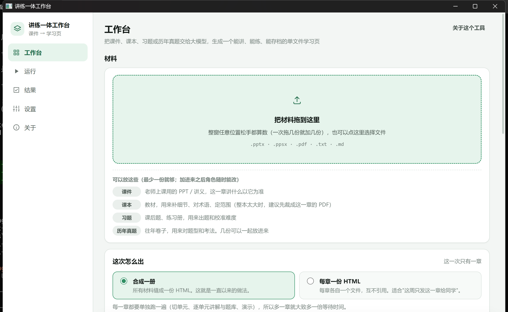

# 讲练一体工作台 · cpp版

把一章课件（PPT / PDF）或教材交给大模型，生成一份**单文件 HTML** 学习材料：讲解和练习挨在一起，点选项立刻判分，关键概念配可拖动的演示，进度自动保存在本地。



## 下载

| 版本 | 说明 |
|---|---|
| [单文件便携版](https://github.com/PurpleRice-wasd/isg-studio-cpp/releases/latest/download/ISG-Studio-Portable-2.0.0-x64.exe) | 双击即用，不写注册表 |
| [安装版](https://github.com/PurpleRice-wasd/isg-studio-cpp/releases/latest/download/ISG-Studio-Setup-2.0.0-x64.exe) | 安装到当前用户，带桌面和开始菜单快捷方式 |
| [SHA256 校验值](https://github.com/PurpleRice-wasd/isg-studio-cpp/releases/latest/download/SHA256SUMS-2.0.0.txt) | 核对下载文件是否完整 |

需要 Windows 10/11 和 WebView2 运行时（Windows 11 自带；Windows 10 若缺少请先安装）。

## 2.0.0 有什么变化

2.0.0 把桌面宿主从 Electron 换成了 C++ + 系统 WebView2。界面、生成逻辑和 skill 内核仍是同一份，所以用起来和 1.4.2 一样。

- **安装包小了很多**：单文件 3.97 MB（原来 127 MB），安装后约 11 MB（原来 444 MB）。
- **PDF 抽取更快**：同一份 143 页 PDF，205 ms（原来 624 ms），约 3 倍。
- **启动和内存基本持平**：页面就绪 654 ms（原来 567 ms），私有内存 96 MB（原来 91 MB）。窗口出现得早，但页面还没画完，不能算启动更快。
- **高分屏更清晰**：修复了 200% 缩放下界面发虚的问题。
- **启动和卸载更稳**：安装后立刻启动偶发的 WebView2 初始化失败会自动重试；卸载不会留下空目录。
- **原来的数据可以直接用**：设置、加密的 API Key、历史和学习进度都与 1.4.2 共用，不需要迁移。

完整变化见 [CHANGELOG.md](CHANGELOG.md)。

## 功能

### 材料与抽取

- 支持 `.pptx`、`.ppsx`、`.pdf`、`.txt`、`.md`，可以拖进窗口，也可以点按钮添加。
- 一次可以放多份材料，每份标一个角色：课件（讲法以它为准）、课本（补细节、定范围）、习题（校准难度）、历年真题（对题型）。角色随时能改，不用重新选文件。
- 多份材料会各自独立分析一遍；历年真题只用来提炼题型和考法，原文不会进提示词。
- 抽取结果先给你看：工作台会标出可疑页（字符数异常低、乱码、整页无文字），这些页的文字可以直接改，生成时用你改后的版本。
- PDF 和 PPTX 直接解析，不需要装 Office 或 PDF 阅读器。

### 生成

- 八阶段流水线：抽取 → 逐来源分析 → 规划 → 生成讲解与题库 → 生成演示 → 拼装 → 校验 → 修复。全程有日志和流式输出，随时可以取消。
- 一章可以切成多个单元，每个单元讲完紧跟 2–4 道题；题型有单选、多选、填数值和综合大题。
- 题目审校：可以设 0–3 位独立审题人。审题人只拿到题库和素材，不看出题过程，从头把答案重算一遍；多人时至少两人报同一题才会自动修改，误报会写进报告。
- 生成后会在后台跑一遍页面自检：题库条目、判分、统计、演示读数逐项检查；没过就带着具体问题重出，默认最多 2 轮。
- 多章：每份材料可以标章号，可以合成一册（一个文件、一个进度条、一个结算区），也可以每章一份。已经生成过前面的章时，可以一键“带上以前的章”，目录、关卡号和进度接着走；接不上就不硬拼。
- 结果页会列出产物、校验报告和修复轮次，可以“重新校验”；生成失败或取消后可以清理留下的文件。

### 学习页

- 单页长文档：讲解和练习在同一页，向下滚动即可，不切页、不分文件。
- 讲完一个知识块，紧接着就是它的题；点选项或填数值立刻判分，正确项着绿、选错项着红，并逐项说明错在哪。
- 每题有“思路提示”和“重做本题”；解析默认收起，答题后展开。综合大题拆成“一步一问”，末尾是学习结算和薄弱关卡诊断。
- 吸顶进度条常驻：已作答 x/N、正确率、错题数；可以“只看错题”、“清空重来”。每章独立存进度，自动保存在本机。
- 可拖演示：读数和图形都由公式现场算出，刻度也由脚本计算，图和数永远一致。
- 数值题容错：`1.06`、`1.06 T`、`2.51e-4`、`2.51×10⁻⁴`、`1,06`、全角数字和印刷体负号都认；写算式会被明确告知“只认一个数字”。
- 题库字段写错会标红跳过并告警，不影响其他题；页面不请求 CDN、网络字体或 MathJax，离线也能看。
- 生成的页面适配手机和平板：安全区、触摸目标不小于 40px、不会自动放大字号；iPad 上常见的 HTML 查看器也能用。

### 陪练

- 右下角有陪练：默认是内置的“大肥鱼”，也可以放自己的 `pet.png` / `pet.jpg` 等同目录图片，或右键先藏起来。
- 按住可以拖走并记住位置；单击跳一下说话；双击在“原地不动 / 跟着鼠标 / 自己溜达”之间切换；右键（手机上长按）可以调模式、大小、形象和速度。
- 台词可以整套换成自己的话：同目录放 `pet-lines.js`，或者写页面里的内联 JSON。键位和优先级见 [pet-guide.md](skills/interactive-study-guide/references/pet-guide.md)。

### 设置与数据

- 支持 DeepSeek、Kimi、通义千问、智谱 GLM、MiniMax、豆包、SiliconFlow、OpenAI、Anthropic、OpenRouter、Gemini、Ollama、LM Studio 和自定义 OpenAI / Anthropic 兼容端点。
- API Key 加密后存在本机，页面拿不到明文；可以测试连接、拉取模型列表、导入和导出设置。
- 可以换背景图、调暗度和模糊、切换浅色 / 深色 / 跟随系统；单元数、题量、演示数、审校人数、内容语言、温度、并发和修复轮数都在设置里。
- 用户数据在 `%APPDATA%\isg-studio`，和 Electron 1.4.2 共用；换版本不需要迁移设置、Key 或历史。

## 怎么用

1. 双击 `ISG-Studio-Portable-2.0.0-x64.exe`，或者运行安装版。
2. 打开「设置」，选一个模型服务，填入 API Key，点「测试连接」。
3. 把课件拖进工作台，设置章节、题量和演示数量。
4. 点「开始生成」。完成后打开生成的 HTML；之后可以在结果页点「重新校验」。

## 从源码构建

需要 Visual Studio 2022/2026（C++ 工具链）、Python 3 和 WebView2 运行时。

```powershell
powershell -File tools\fetch-deps.ps1
powershell -File tools\build.ps1 -BuildDir build3
.\build3\dist\isg-studio.exe
```

`cmake` 和 `ninja` 不在 PATH 也可以，`tools\build.ps1` 会调用 `vcvars64.bat`。

### 打包与自测

```powershell
powershell -File tools\package.ps1 -BuildDir build3
powershell -File tools\run-selftests.ps1 -Exe build3\dist\isg-studio.exe
```

`build-package\` 里会生成安装版和便携版。这个目录不提交进仓库，发布时作为 Release 附件上传。

## 技术文档

- [架构对比：Electron 1.4.2 与 C++ 2.0.0](docs/arch-bench.md)：体积、内存、启动和 PDF 抽取的实测数据。
- [验收报告](docs/acceptance-report.md)：2.0.0 的完整验收结果。报告是在原来的 monorepo 里完成的，开头有独立仓库说明。
- [更新记录](CHANGELOG.md) · [Release 文案](docs/release-notes-2.0.0.md)
- `docs/guidance*.md` 和 `docs/phase*-report.md` 是开发过程笔记，不读也能正常使用。

## 目录

```
src/                             宿主：窗口、桥、设置、抽取、网络、流水线、校验
web/                             界面（和 Electron 1.4.2 同一份）
skills/interactive-study-guide/  运行期 skill 内核（含第三方素材与许可）
docs/                            契约、规格、验收报告、架构对比、发布文案
tools/                           构建、取依赖、打包、自测、假模型服务
CMakeLists.txt
VERSION                          版本号（2.0.0）
CHANGELOG.md
LICENSE                          MIT
```

## 已知限制

- 真实生成需要自备 API Key 和额度；仓库里的自测使用本地假模型。
- 没有在真实手机上验收生成结果的移动端形态。
- PDF 逐页相似度没有达到 99%，原因是公式和表格的阅读顺序与 pdfjs 不同，不是丢字。
- 安装包没有代码签名，首次运行时 Windows 可能弹出 SmartScreen 提示。

## 许可

MIT，见 [LICENSE](LICENSE)。`skills/interactive-study-guide/third-party/dafeiyu-pet/` 是内置陪练形象（MIT，原作者许可和出处见该目录）；再分发时请保留许可原文。
